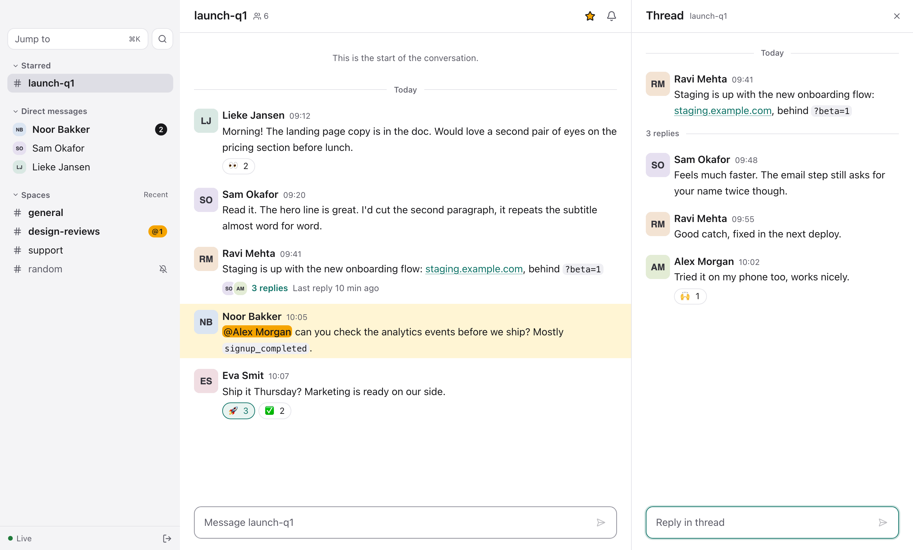
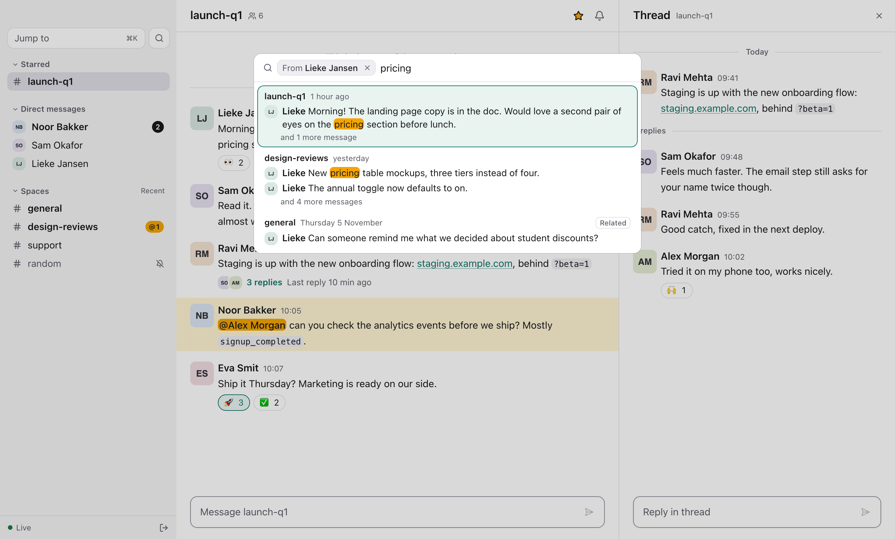

# kwek

A fast, keyboard-first Google Chat client for macOS. *Kwek* is Dutch for roughly
"quack", and for what you call endless chatter.



## What it does

**Read and write**

- Every space, DM and thread from a local cache: switching and scrolling never wait.
- Live updates for messages, edits, reactions and read state, in step with the web and
  your phone.
- Send, reply in a thread, edit, delete, react. Paste, drop or pick images to send them.
- Notifications for DMs and mentions, with sound; a quiet pop-up while kwek is in front.

**Find**

- Search finds the conversation: "demo data" matches the chat where someone said "demo"
  in one message and "dataset" in the next.
- Related results from a small model running on your Mac, for when you remember the
  topic but not the words.
- Narrow down with `from:` and `in:` (pick a name from the list), `before:` and `after:`.
- Your whole history downloads in the background, so search reaches back to the start.



**Everywhere**

- Keyboard first, with Vim keys: `j`/`k`, `⌘K` to jump, `⌘F` to search, `r` to reply.
  `?` lists them all.
- Your own Google Cloud project: no server in between, no telemetry.

## Getting started

kwek needs a Google Workspace account (the Chat API doesn't serve personal Gmail) and
your own small Google Cloud setup, done once in about 15 minutes:
[docs/setup.md](docs/setup.md). It ends with a client file that kwek asks for on first
start.

Download the latest `kwek-<version>.zip` from
[Releases](https://github.com/timvancann/kwek/releases), unzip it and drag kwek into
Applications. It runs on macOS 13 or later, on Apple silicon. If macOS says it can't
check the app, open it once, then click Open Anyway in System Settings, Privacy &
Security.

Or build it yourself, with [Rust](https://rustup.rs), Node with
[pnpm](https://pnpm.io) and [just](https://github.com/casey/just):

```sh
just run       # run from source
just install   # build kwek.app into ~/Applications
```

Its cache, logs and settings live in `~/Library/Application Support/nl.timvancann.kwek/`
and `~/Library/Logs/nl.timvancann.kwek/`. Building and contributing:
[docs/development.md](docs/development.md).

## Inspiration

I spend my working day in Google Chat, and in the browser it never felt quick: every
space switch waits on the network, search finds a word but not the conversation I
meant, and my hands keep leaving the keyboard. kwek is the client I wanted instead.

The layout is Slack's (sidebar, channel, thread panel) without its feature list. The
colours follow [T3 Code](https://github.com/pingdotgg/t3code)'s idea of one grey scale
with a single accent, here a mallard teal, because of the name. The keys come from Vim.
Most of the code was written by [Claude](https://claude.com/claude-code): I wrote the
spec, made the calls and used it every day, and review agents played a picky designer
and a picky Rust engineer before anything counted as done.

## Acknowledgements

kwek stands on these projects:

- [Tauri](https://tauri.app) and [Svelte](https://svelte.dev), with
  [bits-ui](https://bits-ui.com), [shadcn-svelte](https://shadcn-svelte.com) and
  [Tailwind CSS](https://tailwindcss.com) for the interface.
- [SQLite](https://sqlite.org) with FTS5, through
  [rusqlite](https://github.com/rusqlite/rusqlite), for the cache and keyword search.
- [fastembed](https://github.com/Anush008/fastembed-rs) and
  [ONNX Runtime](https://onnxruntime.ai) running
  [multilingual-e5-small](https://huggingface.co/intfloat/multilingual-e5-small) for
  related results.
- [pulldown-cmark](https://github.com/pulldown-cmark/pulldown-cmark) for message
  formatting, [ts-rs](https://github.com/Aleph-Alpha/ts-rs) to keep Rust and TypeScript
  in step, [keyring](https://github.com/hwchen/keyring-rs) for the Keychain.
- Icons from [Lucide](https://lucide.dev).

## Roadmap

- **Dark mode.** Every colour is already a named token, so it starts as a second set of
  values; then it needs checking screen by screen.
- **Other files.** Send PDFs and documents the way images go today.
- **Team builds.** One build your colleagues can open without a client file of their
  own, with a topic per person so nobody's messages pass through anyone else's
  subscription.
- **Signed and notarized releases,** so macOS opens kwek without asking.

## Licence

Apache 2.0 with the [Commons Clause](https://commonsclause.com/) ([LICENSE](LICENSE)):
use, change and share kwek and forks of it freely, including at work. Selling it, a
modified version or a fork, or a paid service built mainly on it, is not allowed.
